# TravelFy AI: Intelligent AI-Powered Travel Planning Platform

**Final Year Project (Bachelor of Science in Computer Science / Software Engineering)**

An AI travel planner that turns a short conversation into a complete, personalised trip itinerary. It combines a **knowledge graph (Graph RAG)**, **vector semantic search** and a **context-aware preference engine** with live weather, currency, flight and hotel data, so every plan respects the traveller's budget, dietary needs and travel style.

<p align="center">
  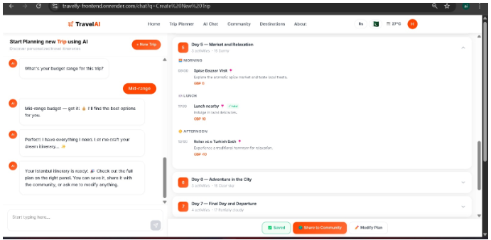
</p>

---

## The problem

Planning a trip means juggling many tabs: destination research, weather, exchange rates, flights, hotels, halal or dietary options, and budget. Generic itinerary tools ignore personal needs and forget everything between sessions.

## The solution

TravelFy AI replaces that with one conversation:

1. Tell the AI where you want to go, for how long, with whom, and on what budget.
2. The system loads your saved preferences and past trips, searches a knowledge graph and a vector index for relevant places, and checks live weather and currency.
3. A language model writes a day-by-day itinerary that fits your needs.
4. Save it, modify it, share it with the community, or plan it together with friends.

---

## Screenshots and key features

### 1. Conversational trip planner
Start with a single sentence, such as "Create a trip for Paris from New York", or use the quick starters: *Create New Trip*, *Inspire me where to go*, *Discover Hidden gems* and *Adventure Destination*.

<p align="center">
  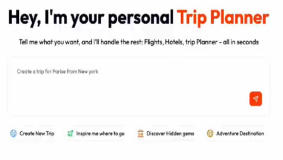
</p>

### 2. Guided chat with an interactive 3D globe
The assistant asks one question at a time (destination, duration, companions, budget, vibe) and offers tappable choices. As soon as a destination is named, the **Mapbox globe** flies to it.

<p align="center">
  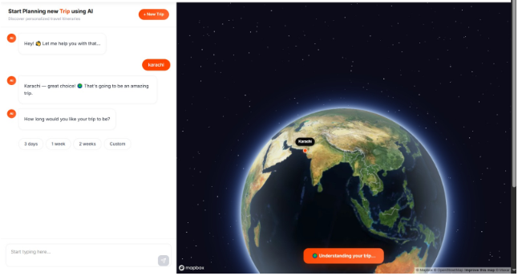
</p>

Interest chips such as *History, Food, Shopping, Adventure, Nature, Nightlife, Culture* and *Relaxation* let the user pick as many as they like, and the map zooms into the chosen city while the trip is being understood.

<p align="center">
  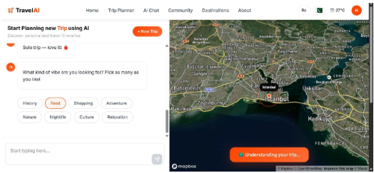
  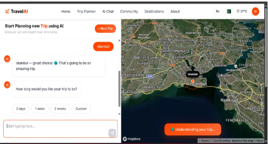
</p>

### 3. Personalised day-by-day itinerary
The generated plan appears next to the chat, organised by day and by time of day (morning, lunch, afternoon), with descriptions, locations, estimated costs, weather per day and dietary tags such as *Halal*. The trip can be **saved**, **shared to the community** or **modified** by asking the AI.

<p align="center">
  
</p>

### 4. Flights and hotels
Flight options and hotel suggestions are shown with airline, route, duration, stops, star rating, guest score and price, with direct **Book on Google / Skyscanner / Booking.com** links.

<p align="center">
  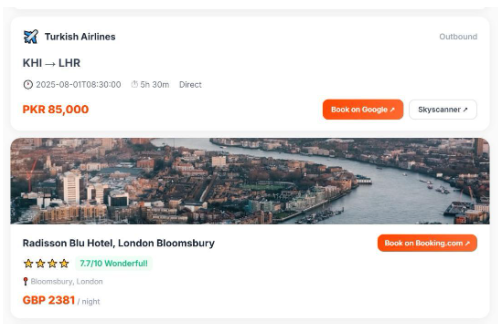
</p>

### 5. Destination explorer with live data
Search any city to see real-time weather, humidity and wind, plus a curated set of nearby places.

<p align="center">
  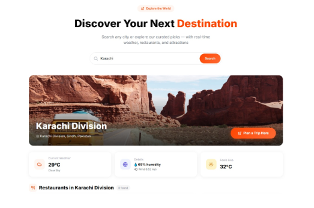
</p>

Nearby services are grouped by category with distances and **View on Map** links. Restaurants are marked **halal by default** where the region requires it, which makes the app useful for Muslim travellers.

<p align="center">
  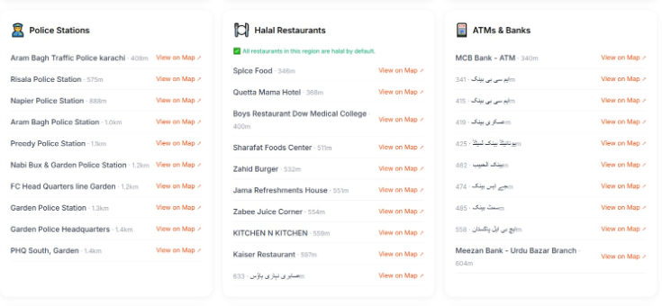
</p>

Top attractions are listed by type, and **UNESCO World Heritage Sites** are shown with their inscription year and a link to the official page.

<p align="center">
  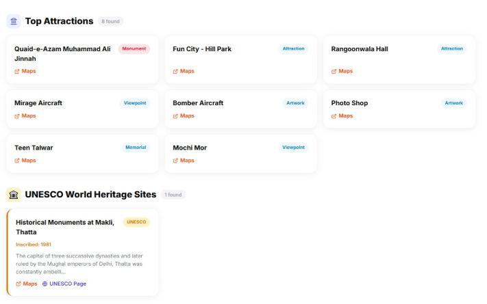
</p>

### 6. Community trips
Travellers can publish their trips. Others can search them, sort by newest, **like**, **comment on**, **clone** a trip into their own account or open a group to plan it together.

<p align="center">
  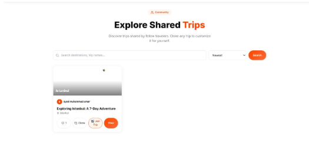
</p>

### 7. Live weather, currency and location in the navigation bar
The navigation bar shows the user's preferred **currency**, detected **country** and current **weather**. Hovering over the weather shows how it feels, humidity, wind speed and the detected city.

<p align="center">
  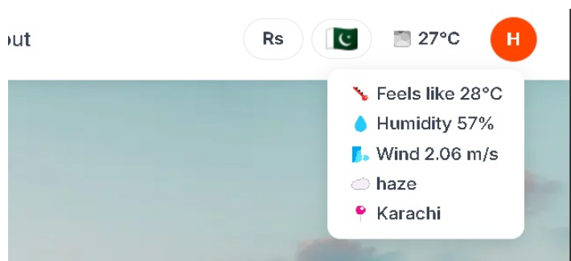
</p>

### More features
- **Context-aware preference engine:** dietary needs, budget, preferred currency, temperature unit, interests, travel style, cuisines and pace are loaded for each user and applied to every service call.
- **Graph RAG (Neo4j):** finds places by tags and relationships, for example halal restaurants near family-friendly attractions in a city.
- **Vector search (Pinecone):** semantic search over place data using OpenAI embeddings.
- **Conversation memory (Redis):** the assistant remembers past conversations and learned preferences.
- **Dashboard:** trip statistics, recent trips, nearby places, local weather, 7-day forecast and currency information.
- **Group trips and real-time collaboration:** create groups, invite members by email or invite code, and use Socket.IO rooms for group chat and live location sharing.
- **Accounts and security:** email sign-up with a one-time-code verification, login, password reset, Google OAuth, bcrypt password hashing, JWT sessions, rate limiting, Helmet and input validation.
- **Admin panel:** manage users and view platform statistics.
- **Export and sharing:** download itineraries as PDF and share trips through a link.
- **Responsive design:** works on desktop, tablet and mobile, with a cookie consent banner and legal pages.

---

## System architecture

```
┌──────────────────────────────────────────────┐
│ Frontend: Next.js (App Router), React        │
│ Zustand stores · Axios API client · Mapbox   │
└──────────────────────┬───────────────────────┘
                       │ REST + Socket.IO
┌──────────────────────┴───────────────────────┐
│ Backend: Express.js                          │
│ Routes → Controllers → Services → Middleware │
│                                              │
│  AI agent pipeline:                          │
│  Preferences + Memory → Graph RAG →          │
│  Vector search → Weather → Currency →        │
│  LLM itinerary → Save to memory              │
└───┬──────────┬──────────┬──────────┬─────────┘
    │          │          │          │
 MongoDB     Redis      Neo4j     Pinecone
(users,     (chat      (knowledge  (vector
 trips)     memory)     graph)      search)
```

## Tech stack

| Layer | Technologies |
|---|---|
| Frontend | Next.js 16 (App Router), React 19, Tailwind CSS 4, Zustand, TanStack Query, React Hook Form, Zod, Mapbox GL, Socket.IO client, jsPDF, Lenis |
| Backend | Node.js, Express 5, Socket.IO, Passport.js (Google OAuth), JWT |
| AI | OpenAI (GPT-4o-mini, embeddings), LangChain / LangGraph |
| Databases | MongoDB (Mongoose), Redis, Neo4j (graph), Pinecone (vectors) |
| External APIs | OpenWeatherMap, ExchangeRate API, OpenStreetMap, flights and hotels APIs |
| Testing | Vitest, Testing Library, fast-check (property-based tests) |
| Deployment | Render (see `render.yaml`) |

## Project structure

```
final-year/
├── frontend/              # Next.js app
│   └── src/
│       ├── app/           # Pages (chat, dashboard, trips, community, admin, ...)
│       ├── components/    # UI kit, chat, map, auth, layout
│       ├── hooks/         # Location, weather, currency hooks
│       ├── store/         # Zustand stores (auth, trips, preferences)
│       └── lib/           # API client, PDF export, map helpers
├── backend/
│   ├── controllers/  routes/  models/  middleware/
│   ├── services/      # ai/, graph/, vector/, memory/, external/
│   ├── sockets/       # Real-time features
│   └── config/        # DB, Neo4j, Pinecone, Redis, Passport
└── render.yaml        # Deployment config
```

## Getting started

### Prerequisites
- Node.js 18 or later
- A MongoDB database (for example MongoDB Atlas)
- API keys for the services you want to enable. The server keeps running if Neo4j, Pinecone or Redis are unavailable, but the related AI features are reduced.

### 1. Clone
```bash
git clone <your-repo-url>
cd final-year
```

### 2. Backend
```bash
cd backend
npm install
cp .env.example .env     # then fill in your own keys
npm run dev              # http://localhost:5000
```

Main environment variables: `MONGODB_URI`, `JWT_SECRET`, `JWT_REFRESH_SECRET`, `OPENAI_API_KEY`, `OPENWEATHER_API_KEY`, `EXCHANGE_RATE_API_KEY`, `NEO4J_URI`, `NEO4J_USER`, `NEO4J_PASSWORD`, `PINECONE_API_KEY`, `PINECONE_INDEX`, `REDIS_URL`, `GOOGLE_CLIENT_ID`, `GOOGLE_CLIENT_SECRET`, `FRONTEND_URL`.

Optionally seed the knowledge graph with sample destinations:
```bash
npm run seed
```

### 3. Frontend
```bash
cd frontend
npm install
```
Create `frontend/.env.local`:
```
NEXT_PUBLIC_API_URL=http://localhost:5000
NEXT_PUBLIC_SOCKET_URL=http://localhost:5000
NEXT_PUBLIC_MAPBOX_TOKEN=your-mapbox-token
```
```bash
npm run dev              # http://localhost:3000
```

### Run the tests
```bash
cd frontend
npm test
```

> **Never commit your `.env` files or API keys.** Only `.env.example` belongs in the repository.

## Team

| Name | Student ID | Role |
|---|---|---|
|SYED MUHAMMAD UMAR |bb-29160 | Full-stack developer |
| SYED TAHA WASTI | _ID_ | QA |
|SYEDA RAMESHA | _ID_ | Full-stack developer |
|MUHAMAMD TALHA | _ID_ | Full-stack developer |

**Supervisor:** SIR AMJAD JUMANI 

## Acknowledgements

Developed as a Final Year Project at the Department of Computer Science / Software Engineering, _University name_.
